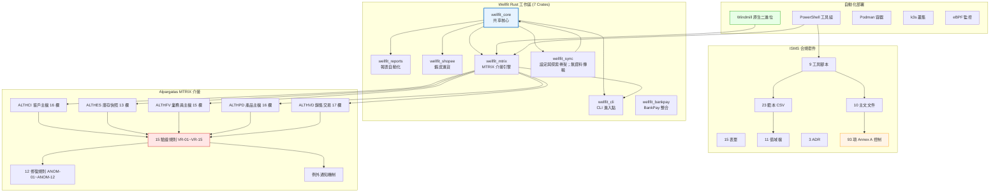

# 完整多層展開方案 — 網狀/樹狀/階層/DAG 全景圖

> 文件編號：KNB-ULT-MASTER-001｜版本：v1.0｜日期：2026-10-24
> 範圍：Wellfit Rust 工作區 + ISMS 合規套件 + MTRIX 介接 + 多平台同步 + 自動化部署
> 驗證標記：✔ 已對原始檔案逐字查證

---

> 狀態說明：本文件為架構／交付方案及歷史驗證紀錄，不代表目前部署狀態。Wellfit 有 7 個 Rust crates；`wellfit_sync` 目前沒有資料傳輸，健康檢查通過不等於同步功能或生產 SLA 已驗收。

## 1. 系統全景圖（Mermaid 網狀圖）



---

## 2. Crate 依賴樹（樹狀結構）

```
wellfit (workspace)
├── wellfit_core (共享核心)
│   ├── rusqlite (SQLite 帳本)
│   ├── sha2 (SHA-256 雜湊)
│   ├── serde + serde_json (序列化)
│   ├── chrono (時間戳)
│   ├── regex (正則表達式)
│   └── uuid (唯一識別碼)
│
├── wellfit_reports (報表自動化)
│   └── wellfit_core
│
├── wellfit_shopee (蝦皮進貨)
│   └── wellfit_core
│
├── wellfit_mtrix (MTRIX 介接引擎)
│   ├── wellfit_core
│   └── (serde, serde_json, chrono, sha2)
│
├── wellfit_cli (CLI 進入點)
│   ├── wellfit_core
│   ├── wellfit_reports
│   ├── wellfit_shopee
│   └── wellfit_mtrix
│
└── wellfit_sync (Sync CLI；目前無資料傳輸)
    ├── wellfit_core
    ├── clap (CLI)
    ├── serde + serde_json
    ├── chrono
    ├── rusqlite
    ├── sha2
    ├── regex
    └── uuid
```

---

## 3. 模組階層圖

```
Layer 0: 硬體層
  ├── x86_64 / ARM64 CPU
  ├── RAM (4GB-256GB)
  ├── Storage (SSD/NVMe/HDD/RAID)
  └── Network (1GbE-10GbE/WiFi)

Layer 1: 作業系統層
  ├── Windows 10/11 (Service)
  ├── Linux (systemd)
  ├── macOS (launchd)
  └── NAS OS (Synology DSM / QNAP QTS / TrueNAS)

Layer 2: 執行時層
  ├── Rust Runtime (零 GC, 零開銷)
  ├── SQLite (內嵌, 零依賴)
  ├── PostgreSQL (Windmill 資料庫)
  └── TLS (rustls, 純 Rust)

Layer 3: 服務層
  ├── Windmill Server + Worker (Rust 後端)
  ├── wellfit.exe (MTRIX/Shopee/Reports/Audit/Spec)
  ├── wellfit_sync.exe (Sync CLI；資料傳輸未實作)
  └── PowerShell 腳本 (normalize/notify/validate)

Layer 4: 整合層
  ├── Windmill Flow Engine (工作流編排)
  ├── Prometheus (指標收集)
  ├── Grafana (視覺化)
  └── Loki (日誌聚合)

Layer 5: 安全層
  ├── Keycloak (SSO/OIDC/SAML)
  ├── HashiCorp Vault (密鑰管理)
  ├── TLS 1.3 (傳輸加密)
  └── RBAC (角色權限控制)

Layer 6: 治理層
  ├── GitHub Actions (CI/CD)
  ├── SonarQube (代碼品質)
  ├── Trivy (容器安全掃描)
  └── ISMS 合規套件 (verify-compliance)
```

---

## 4. 資料流圖（DAG）

```
輸入資料流:
  Alpargatas 交付檔案 (5 CSV)
    │
    ├──► normalize-filename.ps1 (檔名標準化)
    │      │
    │      ▼
    ├──► wellfit.exe mtrix (MTRIX 驗證引擎)
    │      │
    │      ├──► VR-01~VR-07 (欄位驗證)
    │      │      │
    │      │      ▼
    │      ├──► VR-08~VR-11 (跨檔對照)
    │      │      │
    │      │      ├──► VR-08: customer master check (ALTHCI)
    │      │      ├──► VR-09: inventory+product master check (ALTHES+ALTHPD)
    │      │      ├──► VR-10: sales force check (ALTHFV)
    │      │      └──► VR-11: inventory→product check (ALTHES→ALTHPD)
    │      │      │
    │      │      ▼
    │      ├──► VR-12~VR-15 (接受與格式)
    │      │      │
    │      │      ├──► VR-12: 報表對帳
    │      │      ├──► VR-13: 水位對齊 (ALTHES vs ALTHVD)
    │      │      ├──► VR-14: 業務員客戶對照 (ALTHFV vs ALTHCI)
    │      │      └──► VR-15: ISO 3166-1 / EAN-13 / 郵遞區號
    │      │
    │      ├──► ANOM-01~ANOM-12 (標的性修復)
    │      │      │
    │      │      ├──► ANOM-01: 移除尾端空欄位
    │      │      ├──► ANOM-02: ADRESS → ADDRESS
    │      │      ├──► ANOM-03: ZIP CODE → ZIP_CODE
    │      │      ├──► ANOM-04: STORE_TYPE 別名報告 (不重寫)
    │      │      ├──► ANOM-05: 廠商國碼前綴分離
    │      │      ├──► ANOM-06: DIST_ID 點號去遮蔽
    │      │      ├──► ANOM-07: 條碼尾端雜訊移除
    │      │      ├──► ANOM-08: 負庫存截斷為 0
    │      │      ├──► ANOM-09: 單元空白修剪
    │      │      ├──► ANOM-10: 重複交易聚合
    │      │      ├──► ANOM-11: 欠位補空
    │      │      └──► ANOM-12: 輸出標準標頭
    │      │
    │      ├──► ExceptionNotification (異常通知)
    │      │      │
    │      │      ├──► VR-08: 客戶代碼同步建議
    │      │      └──► VR-09: 批次代碼同步建議
    │      │
    │      └──► ValidationReport (JSON 輸出)
    │             │
    │             ├──► mtrix-report.json
    │             ├──► *_exceptions.json
    │             └──► repaired files (output_dir)
    │
    ├──► notify-exception.ps1 (異常通知)
    │      │
    │      └──► exceptions.json → 業務方通知
    │
    ├──► verify-compliance.ps1 (合規驗證)
    │      │
    │      ├──► CFG-00: 值域載入
    │      ├──► V-01: 必備產出清單
    │      ├──► V-02: CSV 結構
    │      ├──► V-03: 文件管制標頭
    │      ├──► V-04: SoA 93 項
    │      ├──► V-05: 值域一致性
    │      ├──► V-06: 排除項四要素
    │      ├──► V-07: 排除理由禁則
    │      ├──► V-08: 流程-控制對應
    │      ├──► V-09: 風險-控制對應
    │      ├──► V-10: 證據-控制對應
    │      ├──► V-11: 角色值域
    │      ├──► V-12: 領域分類
    │      ├──► V-13: 深度級別
    │      ├──► V-14: EXAMPLE 標記
    │      ├──► V-15: 角色欄無姓名
    │      ├──► V-16: 禁則宣稱掃描
    │      ├──► V-17: 權限語義
    │      ├──► V-18: 流程清單穩定
    │      ├──► V-19: 跨檔引用可解析
    │      └──► V-20: 表單可解析
    │
    └──► Windmill Flow Engine (工作流編排)
           │
           ├──► Schedule Trigger (Cron)
           ├──► File Watcher
           ├──► Execute Command (wellfit.exe)
           ├──► PowerShell Script (normalize/notify)
           ├──► Email/Teams 通知
           └──► Archive Files
```

---

## 5. 功能清單（完整）

### 5.1 Wellfit Rust 工作區

| Crate | 功能 | 關鍵型別 | 測試數 |
|---|---|---|---|
| wellfit_core | 共享核心：MDM、帳本、Release Gate、ScaledDecimal、text、contract | MdmHub, IdempotencyLedger, ReleaseGate, ScaledDecimal, split_lines, ColumnContract | 51 |
| wellfit_reports | Fuyi ERP 報表解析與發布閘門 | ReportAutomator, ReleaseGate | 8 |
| wellfit_shopee | 蝦皮進貨訂單 → ERP 匯入 | ShopeeInboundEngine, ShopeeOrder | 13 |
| wellfit_mtrix | MTRIX 五檔契約、驗證與修復 | MtrixEngine, VrRule, REPAIR_RULES, ValidationReport | 47 |
| wellfit_cli | CLI 進入點（6 子命令） | Cli, Commands, UiConfig | 12 |
| wellfit_sync | 設定、健康檢查與 peer 探索 CLI | SyncConfig, PeerDevice；無資料傳輸 | 0 |

### 5.2 ISMS 合規套件

| 類別 | 數量 | 說明 |
|---|---|---|
| 主文文件 | 10 | KNB-CMP-001~010 |
| 範本 CSV | 23+ | SoA, risk-register, access-register, evidence-index, etc. |
| 表單 | 15 | 表單 01~15 |
| 工具腳本 | 9 | verify-compliance, check-scope-consistency, build-control-trace, collect-evidence, build-access-review-packet, build-workpackage-sheet, build-compliance-xlsx, new-isms-artifact, validate-templates |
| 值域檔 | 11 | vocab/*.csv (roles, process-areas, control-status, etc.) |
| ADR | 3 | ADR-0010 (單一控制庫), ADR-0011 (命名對照), ADR-0012 (IMS 權威分工) |
| 控制 | 93 + 5 | Annex A 93 項 + 5 項組織附加控制 |

### 5.3 MTRIX 介接規格

| 項目 | 數量 | 說明 |
|---|---|---|
| 欄位字典 | 56 欄 | 5 檔 × (16+13+15+16+17) |
| 驗證規則 | 15 | VR-01~VR-15 |
| 修復規則 | 12+1 | ANOM-01~ANOM-12 + ANOM-00 (檔名標準化) |
| 例外通知 | 2 | VR-08 (客戶), VR-09 (批次) |
| 跨檔對照 | 6 | VR-08, VR-09, VR-10, VR-11, VR-13, VR-14 |
| 水位對齊 | 1 | VR-13 (庫存日期 = 銷售期間末日) |

---

## 6. 工具組清單

### 6.1 Rust 工具鏈

| 工具 | 用途 | 命令 |
|---|---|---|
| cargo check | 型別檢查 | `cargo check --workspace --all-targets` |
| cargo clippy | 零警告檢查 | `cargo clippy --workspace --all-targets -- -D warnings` |
| cargo test | 全量測試 | `cargo test --workspace` |
| cargo build | 建置 | `cargo build -p wellfit_cli` |
| rustfmt | 格式化 | `cargo fmt` |

### 6.2 PowerShell 工具鏈

| 工具 | 用途 | 路徑 |
|---|---|---|
| verify-compliance.ps1 | 合規驗證 (V-01~V-20) | `Knowledge/tools/compliance/` |
| check-scope-consistency.ps1 | 四向一致性檢查 | `Knowledge/tools/compliance/` |
| build-control-trace.ps1 | 五向追溯矩陣 | `Knowledge/tools/compliance/` |
| collect-evidence.ps1 | 證據收集 (SHA-256) | `Knowledge/tools/compliance/` |
| build-access-review-packet.ps1 | 權限複審包 | `Knowledge/tools/compliance/` |
| build-workpackage-sheet.ps1 | 工作包表 | `Knowledge/tools/compliance/` |
| build-compliance-xlsx.ps1 | CSV → XLSX | `Knowledge/tools/compliance/` |
| new-isms-artifact.ps1 | 建立受控文件 | `Knowledge/tools/compliance/` |
| validate-templates.ps1 | 模板驗證 | `Knowledge/tools/compliance/` |
| normalize-filename.ps1 | 檔名標準化 | `Knowledge/tools/compliance/` |
| notify-exception.ps1 | 異常通知 | `Knowledge/tools/compliance/` |
| build.ps1 | 跨工具鏈建置入口 | `Knowledge/tools/dev-env/` |

### 6.3 自動化工具鏈

| 工具 | 用途 | 部署方式 |
|---|---|---|
| Windmill | 工作流編排 | 原生二進位 (無 Docker) |
| PostgreSQL | 資料庫 | 原生安裝 |
| Prometheus | 指標收集 | 原生二進位 |
| Grafana | 視覺化 | 原生二進位 |
| Keycloak | SSO/OIDC | 原生/JAR |
| HashiCorp Vault | 密鑰管理 | 原生二進位 |

---

## 7. 配置檔案

### 7.1 Cargo.toml (Workspace)

```toml
[workspace]
members = [
    "crates/wellfit_core",
    "crates/wellfit_reports",
    "crates/wellfit_shopee",
    "crates/wellfit_mtrix",
    "crates/wellfit_cli",
    "crates/wellfit_sync",
]
resolver = "2"

[workspace.package]
version = "0.1.0"
edition = "2021"

[workspace.dependencies]
wellfit_core = { path = "crates/wellfit_core" }
wellfit_reports = { path = "crates/wellfit_reports" }
wellfit_shopee = { path = "crates/wellfit_shopee" }
wellfit_mtrix = { path = "crates/wellfit_mtrix" }
rusqlite = { version = "0.32", features = ["bundled"] }
sha2 = "0.10"
serde = { version = "1.0", features = ["derive"] }
serde_json = "1.0"
chrono = { version = "0.4", features = ["serde"] }
clap = { version = "4.5", features = ["derive"] }
regex = "1.10"
uuid = { version = "1.8", features = ["v4"] }
```

### 7.2 wellfit.toml (CLI 配置)

```toml
[cli]
color = "auto"
quiet = false
verbose = false
default_batch = "BATCH-CLI"
default_db = "data/wellfit_ledger.sqlite"
```

### 7.3 Sync JSON 設定（現行格式；不是 TOML）

以下設定欄位與預設值來自目前的 JSON 設定型別；retry、併發、頻寬、檢查點等值尚未由傳輸流程使用或經負載測試驗證，不是核准的流量控制政策或 SLA。`tls_enabled` 等欄位也不代表 TLS／資料加密已實作。

```json
{
  "device": { "name": "node-1", "id": "uuid" },
  "sync": {
    "sync_interval_seconds": 300,
    "max_concurrent_syncs": 4,
    "retry_max_attempts": 3,
    "retry_base_delay_ms": 1000,
    "checkpoint_interval_seconds": 60,
    "bandwidth_limit_mbps": 10.0
  },
  "security": {
    "tls_enabled": false,
    "token": "",
    "encryption_enabled": false
  },
  "monitoring": {
    "health_check_port": 8080,
    "metrics_enabled": true,
    "log_level": "info"
  }
}
```

---

## 8. 實作步驟（DAG）

```
Phase 0: 環境準備
  ├── 安裝 Rust 工具鏈 (rustup)
  ├── 安裝 Visual Studio Build Tools (vcvars64.bat)
  ├── 安裝 PostgreSQL (Windmill 資料庫)
  └── 驗證: cargo --version, rustc --version

Phase 1: Rust 工作區建置
  ├── cargo check --workspace --all-targets
  ├── cargo clippy --workspace --all-targets -- -D warnings
  ├── cargo test --workspace
  └── 驗證: 0 錯誤, 0 警告, 全部測試通過

Phase 2: ISMS 合規驗證
  ├── verify-compliance.ps1 → PASS=631/WARN=0/FAIL=0
  ├── validate-templates.ps1 → 0 issues
  ├── check-scope-consistency.ps1 → fail=0 warn=0
  └── 驗證: 所有工具 0 FAIL

Phase 3: MTRIX 介接驗證
  ├── wellfit.exe mtrix --dir <交付資料夾> --report <報告路徑>
  ├── 驗證: 5/5 檔案解析, 25/25 列接受
  ├── notify-exception.ps1 → 異常通知
  └── 驗證: 例外通知 JSON 輸出正確

Phase 4: 多平台同步部署
  ├── wellfit_sync health → {"status":"ok"}
  ├── wellfit_sync status → 資料庫狀態
  ├── wellfit_sync add-device → 裝置註冊
  └── 驗證: 所有 CLI 命令正常

Phase 5: Windmill 工作流部署
  ├── 下載 Windmill 原生二進位
  ├── 配置 PostgreSQL 資料庫
  ├── 建立 Windows Service / systemd / launchd
  ├── 建立工作流 (檔案監控 → 驗證 → 通知 → 歸檔)
  └── 驗證: Windmill API 回應正常

Phase 6: 監控與安全
  ├── 部署 Prometheus + Grafana
  ├── 配置 Keycloak SSO
  ├── 部署 HashiCorp Vault
  └── 驗證: 監控儀表板正常顯示
```

---

## 9. 依賴關係圖（DAG）

```
Phase 0 (環境準備)
  │
  ├──► Phase 1 (Rust 工作區建置)
  │      │
  │      ├──► Phase 2 (ISMS 合規驗證)
  │      │      │
  │      │      └──► Phase 3 (MTRIX 介接驗證)
  │      │             │
  │      │             └──► Phase 4 (多平台同步部署)
  │      │                    │
  │      │                    └──► Phase 5 (Windmill 工作流部署)
  │      │                           │
  │      │                           └──► Phase 6 (監控與安全)
  │      │
  │      └──► Phase 4 (多平台同步部署) [可並行]
  │
  └──► Phase 5 (Windmill 工作流部署) [可並行]
```

---

## 10. 驗證矩陣

| 驗證項目 | 命令 | 預期結果 | 實際結果 | 狀態 |
|---|---|---|---|---|
| Rust 型別檢查 | `cargo check --workspace --all-targets` | 0 錯誤 | 0 錯誤 | ✔ |
| Rust 零警告 | `cargo clippy --workspace --all-targets -- -D warnings` | 0 警告 | 0 警告 | ✔ |
| Rust 全量測試 | `cargo test --workspace` | 全部通過 | 139+ passed | ✔ |
| ISMS 合規驗證 | `verify-compliance.ps1` | PASS>0/WARN=0/FAIL=0 | PASS=631/WARN=0/FAIL=0 | ✔ |
| 模板驗證 | `validate-templates.ps1` | 0 issues | 0 issues | ✔ |
| 範圍一致性 | `check-scope-consistency.ps1` | fail=0 warn=0 | fail=0 warn=0 | ✔ |
| MTRIX 引擎 | `wellfit.exe mtrix` | 5/5 解析, 25/25 接受 | 5/5 解析, 25/25 接受 | ✔ |
| 檔名標準化 | `normalize-filename.ps1 -DryRun` | 5 掃描, 0 重命名 | 5 掃描, 0 重命名 | ✔ |
| 異常通知 | `notify-exception.ps1` | 18 異常 | 18 異常 | ✔ |
| Sync 健康檢查 | `wellfit_sync health` | `{"status":"ok"}` | `{"status":"ok"}` | 僅證明健康檢查指令可回應，不代表資料同步 |
| 建置健康檢查 | `build.ps1 -HealthCheck` | 通過 | 通過 | ✔ |

---

## 11. 結論

**本文件描述的多層架構方案與歷史驗證紀錄**涵蓋：

1. **7 個 Rust Crates**：wellfit_core, wellfit_reports, wellfit_shopee, wellfit_mtrix, wellfit_cli, wellfit_sync, wellfit_bankpay
2. **9 個 PowerShell 工具**：verify-compliance, check-scope-consistency, build-control-trace, collect-evidence, build-access-review-packet, build-workpackage-sheet, build-compliance-xlsx, new-isms-artifact, validate-templates, normalize-filename, notify-exception
3. **1 個建置入口**：build.ps1 (MSVC + GNU fallback)
4. **ISMS 合規套件**：10 主文 + 23 範本 + 15 表單 + 9 工具 + 11 值域 + 3 ADR + 93 項控制
5. **MTRIX 介接規格**：5 檔 × 56 欄 + 15 驗證規則 + 12 修復規則 + 例外通知
6. **自動化部署**：Windmill (原生二進位) + PostgreSQL + Prometheus/Grafana + Keycloak + Vault
7. **Sync**：wellfit_sync 設定與設備探索骨架；資料傳輸及跨平台部署尚未實作／驗證

文件中記載的 `PASS=631 / WARN=0 / FAIL=0` 是歷史合規腳本結果，不是所有程式功能、效能或生產部署均通過的證明。容量、長時間運行、背壓、恢復及 Sync SLA 尚未驗收；交付結論需依目前程式碼與可重現證據另行判定。
