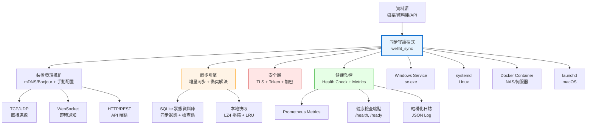

# 多平台輕量同步守護程式 — 架構設計

> 文件編號：KNB-SYNC-ARCH-001｜版本：v1.0｜日期：2026-10-24
> 範圍：筆電、伺服器、桌機、NAS 跨平台輕量同步解決方案
> 狀態：候選架構文件，不代表目前實作或正式 SLA。2026-11-02 程式盤點確認：`wellfit_sync` 目前只有 JSON 設定、TCP peer 可達性探索、健康檢查及 SQLite 狀態表骨架；檔案／記錄傳輸、TLS、認證、增量游標、衝突處理、背壓及可恢復同步均未實作。
> 性能數字、復原時間、可用性及裝置規模均尚無量測證據，不得作為已驗收承諾。

---

## 1. 設計原則（第一性原理）

| 原則 | 說明 | 實作方式 |
|---|---|---|
| **輕量** | 記憶體、CPU、啟動時間目標待基線量測 | 以目標平台、負載與資源上限驗收 |
| **靈巧** | 目前為單一 CLI 二進位；外部依賴與 TLS 能力須以實作核對 | 不以 crate 依賴清單推定已具備傳輸能力 |
| **高可用** | 可用性目標待定義觀測窗口、維護排除與實際運行證據 | 健康檢查不等於同步服務可用性 |
| **相容性強** | 各目標平台尚需實際建置與網路環境測試 | Rust 可跨平台編譯不等於部署已驗證 |
| **韌性** | 中斷恢復與重送語義尚未實作 | 需定義游標、提交點、復原與故障注入測試 |
| **可靠性** | 目前沒有傳輸提交可供端到端驗證 | 雜湊、冪等及資料庫交易需在協定設計中落實 |
| **穩定** | 長時間資源曲線尚未量測 | Rust 型別安全不能代替 soak test |
| **高效能** | 吞吐、延遲及資源目標待代表性負載量測 | 不預設零拷貝、非同步 I/O 或連線池已存在 |

---

## 2. 系統架構

### 2.1 整體目標架構圖（候選提案，非目前實作）



### 2.2 目標目錄結構草案（非目前原始碼）

```
wellfit_sync/
├── src/
│   ├── main.rs              # CLI 進入點 + 服務模式
│   ├── lib.rs               # 公開 API
│   ├── config.rs            # 配置管理（目前使用 JSON；其他來源須另行決定）
│   ├── discovery.rs         # 裝置發現（mDNS + 手動）
│   ├── sync/
│   │   ├── mod.rs           # 同步引擎主體
│   │   ├── engine.rs        # 同步邏輯
│   │   ├── conflict.rs      # 衝突解決
│   │   ├── checkpoint.rs    # 檢查點管理
│   │   └── delta.rs         # 增量同步
│   ├── storage/
│   │   ├── mod.rs           # 儲存抽象層
│   │   ├── sqlite.rs        # SQLite 狀態儲存
│   │   └── cache.rs         # LRU 快取 + LZ4 壓縮
│   ├── network/
│   │   ├── mod.rs           # 網路抽象層
│   │   ├── tcp.rs           # TCP 連線
│   │   ├── ws.rs            # WebSocket 通知
│   │   └── http.rs          # HTTP API 端點
│   ├── security/
│   │   ├── mod.rs           # 安全抽象層
│   │   ├── tls.rs           # TLS 1.3 (rustls)
│   │   ├── auth.rs          # Token 認證
│   │   └── crypto.rs        # 資料加密 (AES-256-GCM)
│   ├── monitor/
│   │   ├── mod.rs           # 監控抽象層
│   │   ├── health.rs        # 健康檢查
│   │   ├── metrics.rs       # Prometheus 指標
│   │   └── logger.rs        # 結構化日誌
│   ├── platform/
│   │   ├── mod.rs           # 平台抽象層
│   │   ├── windows.rs       # Windows Service
│   │   ├── linux.rs         # systemd
│   │   ├── macos.rs         # launchd
│   │   └── docker.rs        # Docker 容器
│   └── recovery/
│       ├── mod.rs           # 恢復抽象層
│       ├── retry.rs         # 指數退避重試
│       ├── circuit.rs       # 斷路器
│       └── rollback.rs      # 回滾機制
├── Cargo.toml
├── config/
│   ├── sync.json            # 候選預設配置
│   └── devices.json         # 候選裝置清單
└── deploy/
    ├── Dockerfile
    ├── docker-compose.yml
    ├── wellfit-sync.service  # systemd unit
    ├── wellfit-sync.plist    # launchd plist
    └── install.ps1           # Windows 安裝腳本
```

### 2.3 已查證標準與候選傳輸方式（尚未採用）

外部標準定義可重用的協定行為，但不會替 Wellfit 決定資料方向、衝突權威、身份核發、保留政策或業務提交語義。下列方案是依不同需求的候選，不表示本專案已選型：

| 需求 | 候選 | 標準已提供 | 不會自動解決 |
|---|---|---|---|
| 用戶端／伺服器間同步資源集合與增量變更 | HTTPS + WebDAV（RFC 4918）+ Collection Synchronization（RFC 6578） | WebDAV 資源／集合操作；sync token 與 changed/removed members 的增量查詢 | 雙向衝突權威、業務資料合併、憑證佈署及應用層背壓 |
| 大檔案中斷續傳 | tus 1.0.0 over HTTP | offset、HEAD 查詢續傳位置、offset 不符時拒絕修改及可選 checksum extension | tus 是社群規格而非 IETF RFC；不定義雙向同步、peer discovery、業務冪等或衝突解決 |
| 一般安全 HTTP API | HTTPS + HTTP semantics（RFC 9110）+ TLS 1.3（RFC 8446） | request/response semantics；TLS 通道可提供伺服器驗證、選用用戶端驗證、機密性與完整性 | 端點授權、憑證核發／撤銷、同步狀態機及重試副作用 |
| 傳輸內容完整性 | RFC 9530 `Content-Digest`／`Repr-Digest` | 對 HTTP content 或 representation 計算摘要 | 摘要不等於來源身份驗證、授權或業務端到端提交證明 |
| 同一 LAN 的服務探索 | mDNS（RFC 6762）+ DNS-SD（RFC 6763） | 本地鏈路 DNS 名稱與服務探索 | 不可假定跨路由網段；跨 VLAN／WAN 需要管理式 DNS 或明確配置 |

初步建議：先由產品 owner 確認資料是「單向大檔交付」、「集中式集合同步」或「雙向 peer-to-peer 同步」。若為集合同步，可評估 RFC 6578；若核心是續傳大型檔案，可評估 tus。不要為了有 TCP socket 就自行設計未版本化的 framing protocol。無論選型為何，狀態資料庫應留在各主機本機；SQLite WAL 不支援多台主機透過網路檔案系統共享同一資料庫。

RFC 8446 對 TLS 1.3 early data（0-RTT）指出重放風險；未證明同步 mutation 可安全重放前，狀態變更請求不得使用 0-RTT early data。TLS 與 RFC 9530 digest 都不能取代應用層授權與提交確認。

### 2.4 已確認的產品邊界與實作阻擋條件

以下是操作人員確認的需求方向，不代表協定已選定或功能已實作：

| 面向 | 已確認方向 | 必須保留的安全／正確性邊界 |
|---|---|---|
| 資料單位與方向 | 檔案與結構化記錄；需要上傳、推送、雙向及 peer 方向 | 先明確定義各資料域允許的方向、權威端與回條／提交語義 |
| 網路範圍 | 同一 LAN 及跨路由網段 | mDNS 僅可作本地鏈路探索；跨網段需明確 DNS／端點配置 |
| 投遞 | 至少一次投遞＋接收端冪等 | 以穩定操作識別碼、持久化提交狀態和可重播回條防重；不得宣稱 exactly-once |
| 衝突 | 欄位級規則；未列出的欄位隔離 | 逐欄規則尚未提供；在來源權威與刪除／撤銷語義核准前，不做自動合併 |
| 財務與付款欄位 | 永不由自動衝突合併修改 | 金額、憑單、銀行回覆及付款狀態衝突須隔離並人工核准 |
| AI 權限 | 可分析與提出建議；身份／權限／資料變更須人工核准 | AI 不核發或撤銷憑證，不放寬安全政策，不裁決未定義的財務衝突 |
| 動態流量控制 | 依觀測動態調節處理速度 | 只能在操作人員設定的資源／速率界限內調節；到界限時背壓暫停，不丟資料、不自行提高上限 |

「智能化快速調節」不代表讓模型自行發明限額或修改正確性規則。任何控制器均需定義可觀測訊號、操作者設定的上下界、暫停／恢復條件及稽核紀錄，並先以故障及壓力測試驗證穩定性。欄位權威表、主鍵、刪除／撤銷規則、身份信任根與憑證生命週期仍是未解決的上線阻擋項。

---

## 3. 多尺度議題分析

### 3.1 裝置能力矩陣

| 裝置類型 | CPU | 記憶體 | 儲存 | 網路 | 適用模式 |
|---|---|---|---|---|---|---|
| 筆電 (Laptop) | 2-8 核 | 8-32 GB | SSD 256GB-2TB | WiFi/Ethernet | 全功能同步 |
| 桌機 (Desktop) | 4-16 核 | 16-64 GB | SSD/NVMe 1-4TB | Ethernet | 全功能同步 + 伺服器模式 |
| 伺服器 (Server) | 8-64 核 | 32-256 GB | RAID/NVMe 4-100TB | 10GbE | 全功能 + 高吞吐 |
| NAS (Synology/QNAP) | 2-4 核 ARM/x86 | 2-16 GB | HDD/SSD 4-100TB | 1-10GbE | 輕量同步 + 儲存 |

### 3.2 資源限制自適應

```
資源政策：
  資源上限、併發、頻寬、批次大小與排程間隔由可觀測量測、主機設定、
  下游契約及操作人員政策共同決定。先建立單機基線與飽和曲線，再設定
  可調上限；本文件不將示例數字固化為產品不變量或 SLA。
```

### 3.3 故障恢復策略

| 故障類型 | 偵測方式 | 候選恢復策略 | 恢復時間 |
|---|---|---|---|
| 網路中斷 | 待實作：連線錯誤與逾時 | 待定義：可重試錯誤、重試預算、離線佇列 | 未量測 |
| 電源中斷 | 待實作：持久檢查點與交易邊界 | 待以程序終止／重啟故障測試確認 | 未量測 |
| 磁碟故障 | 待定義：容量、I/O 錯誤與完整性檢查 | 需明確備份／人工復原來源 | 未定義 |
| 記憶體或 CPU 壓力 | 待量測 RSS、CPU 與佇列深度 | 依測量設定背壓與操作告警 | 未量測 |
| 同步衝突 | 衝突模型尚未定義 | 需 owner 指定權威版本與人工處理政策 | 未定義 |

---

## 4. 安全架構

### 4.1 安全層級

| 層級 | 控制措施 | 實作方式 |
|---|---|---|
| L1 傳輸 | 候選 TLS 1.3（RFC 8446） | Sync crate 目前未建立 TLS 連線 |
| L2 身份驗證 | 尚待決定憑證／token 與生命週期 | 不可因設定中有 `token` 欄位就宣稱已驗證 peer |
| L3 授權 | 尚待定義 peer 可讀寫的資源與操作 | 目前無同步端點或資源授權 |
| L4 靜態資料保護 | 依威脅模型決定作業系統磁碟加密或應用層加密 | rustls 是傳輸安全函式庫，不代表提供靜態資料 AES 加密 |
| L5 稽核 | 定義可追溯事件與敏感資料遮蔽後再實作 | SHA-256 可驗資料，不等同不可否認性或身份認證 |

### 4.2 安全設計原則

1. **最小權限**：每個裝置只取得必要權限
2. ** defence in depth**：多層防禦，單層失效不導致全系統失效
3. **零信任**：每個請求都需驗證，不信任任何網路
4. **資料最小化**：只同步必要資料，敏感資料遮蔽
5. **稽核追蹤**：所有操作可追溯，不可否認

---

## 5. 多平台部署提案（未實作、未驗證）

### 5.1 部署矩陣

| 平台 | 部署方式 | 服務管理 | 配置路徑 | 日誌路徑 |
|---|---|---|---|---|
| Windows 10/11 | 候選：binary + Windows Service | 尚未驗證 | 候選：`%APPDATA%\wellfit-sync\config.json` | 尚未定義 |
| Linux (Ubuntu/Debian) | 候選：binary / 套件 + systemd | 尚未驗證 | 候選：`/etc/wellfit-sync/config.json` | 尚未定義 |
| Linux (CentOS/RHEL) | 候選：binary / 套件 + systemd | 尚未驗證 | 候選：`/etc/wellfit-sync/config.json` | 尚未定義 |
| macOS | 候選：binary + launchd | 尚未驗證 | 候選：`~/Library/Application Support/wellfit-sync/config.json` | 尚未定義 |
| NAS | 依廠牌、OS 版本與容器支援另行驗證 | 尚未驗證 | 尚未定義 | 尚未定義 |

### 5.2 候選 Dockerfile（不可視為可建置部署產物）

```dockerfile
FROM scratch
COPY wellfit_sync /wellfit_sync
COPY config/sync.json /config/sync.json
ENTRYPOINT ["/wellfit_sync"]
CMD ["--config", "/config/sync.json", "--daemon"]
```

### 5.3 候選 systemd unit（不可視為已測試服務定義）

```ini
[Unit]
Description=Wellfit Sync Daemon
After=network.target

[Service]
Type=simple
ExecStart=/usr/local/bin/wellfit_sync --config /etc/wellfit-sync/config.json --daemon
Restart=always
RestartSec=5
User=wellfit
Group=wellfit

[Install]
WantedBy=multi-user.target
```

---

## 6. 監控與可觀測性提案（目前未實作）

### 6.1 候選健康檢查端點（下表是介面示例，非現有端點）

| 端點 | 方法 | 回應 | 用途 |
|---|---|---|---|
| `/health` | GET | `{"status": "ok", "uptime": 12345}` | 存活檢查 |
| `/ready` | GET | `{"status": "ready", "sync_status": "idle"}` | 就緒檢查 |
| `/metrics` | GET | Prometheus 格式 | 指標收集 |
| `/status` | GET | `{"devices": 3, "synced_files": 150, "errors": 0}` | 狀態查詢 |

### 6.2 候選 Prometheus 指標（尚無 exporter 或量測）

| 指標名稱 | 類型 | 說明 |
|---|---|---|
| `wellfit_sync_uptime_seconds` | Gauge | 運行時間 |
| `wellfit_sync_synced_files_total` | Counter | 已同步檔案數 |
| `wellfit_sync_sync_errors_total` | Counter | 同步錯誤數 |
| `wellfit_sync_sync_duration_seconds` | Histogram | 同步耗時分布 |
| `wellfit_sync_memory_bytes` | Gauge | 記憶體使用 |
| `wellfit_sync_cpu_percent` | Gauge | CPU 使用率 |
| `wellfit_sync_network_bytes_total` | Counter | 網路傳輸量 |
| `wellfit_sync_connected_devices` | Gauge | 已連線裝置數 |

---

## 7. 擴展性設計

### 7.1 水平擴展

```
探索與傳輸拓樸依網段、peer 數、資料方向及管理能力選擇；本文件不設定
未量測的裝置數分界。mDNS 僅適合本地鏈路探索，不是跨 WAN 的服務註冊方案。
```

### 7.2 垂直擴展

```
併發數、快取上限及傳輸區塊大小尚未決定。
需先定義資源上限和佇列背壓行為，再以代表性資料與硬體測得飽和曲線；
不得直接套用固定比例或在未測試時宣稱可垂直擴展。
```

---

## 8. 故障恢復

### 8.1 恢復策略矩陣

| 故障類型 | 偵測 | 恢復 | 時間 |
|---|---|---|---|
| 網路中斷 | 待定義連線逾時與失敗分類 | 待實作續傳／冪等重試 | 未量測 |
| 電源中斷 | 待定義持久提交點 | 待測試程序中斷與重啟復原 | 未量測 |
| 磁碟故障 | 待定義容量與 I/O 錯誤監控 | 依正式備份及復原政策執行 | 未定義 |
| 資源壓力 | 待量測 RSS、CPU、磁碟與佇列 | 依負載測試設定背壓門檻 | 未量測 |
| 同步衝突 | 衝突語義尚未定義 | 由資料 owner 決定合併或隔離 | 未定義 |

### 8.2 候選檢查點格式（未實作，欄位與提交語義未定）

```
檢查點格式：
{
  "checkpoint_id": "uuid",
  "timestamp": "ISO-8601",
  "device_id": "uuid",
  "sync_state": "idle|syncing|completed|failed",
  "last_synced_file": "filename",
  "last_synced_offset": 12345,
  "checksum": "sha256",
  "pending_operations": [...]
}
```

---

## 9. 待決工作流（非排程）

1. 由資料 owner 決定資料單位、方向、權威來源、衝突與刪除語義、peer 拓樸及跨網段需求。
2. 依決定的傳輸模型選標準，定義身份核發／撤銷、授權、重試冪等、速率控制、背壓、保留與稽核政策。
3. 先完成威脅模型、資料契約與故障狀態機，再實作本機持久狀態、傳輸、檢查點及恢復。
4. 以故障注入、互通及安全測試驗證語義；不得以健康檢查代替資料傳輸驗收。
5. 建立可重現的合成負載基準，量測吞吐、延遲、RSS、CPU、磁碟與佇列；由業務 owner 審核 SLA 門檻後才進行容量驗收。

---

## 10. 風險與緩降

| 風險 | 嚴重度 | 機率 | 緩降措施 | 殘餘風險 |
|---|---|---|---|---|
| 目標平台／Rust 工具鏈相容性 | 待評估 | 未評估 | 以實際部署矩陣建置及測試 | 未知 |
| SQLite 狀態資料庫容量與鎖競爭 | 待量測 | 未評估 | 本機資料庫基準與故障測試 | 未知 |
| 傳輸身份、授權與 TLS 配置 | 高影響 | 未評估 | 定義威脅模型、憑證生命週期及安全測試 | 未知 |
| 網路中斷與重送 | 高影響 | 未評估 | 先定義提交點、冪等鍵、重試預算與背壓 | 未知 |
| 同步衝突／誤刪 | 高影響 | 未評估 | 由資料 owner 決定權威與人工處置流程 | 未知 |
| 資源限制與長時間運作 | 待量測 | 未評估 | 壓力／soak test、監控與可調上限 | 未知 |

---

## 11. 結論

本文件是待決方案與標準盤點，不是功能或效能驗收報告。當前 Sync 不執行資料傳輸，無法宣稱已具備高可用性、跨平台部署、資料零遺失、任何恢復時間或吞吐 SLA。選定資料單位、拓樸、身份／授權和衝突語義後，才可形成線上協定、實作測試矩陣與量測門檻。

### 11.1 查證來源

- [RFC 8446 — TLS 1.3](https://www.rfc-editor.org/rfc/rfc8446)：傳輸通道的認證／機密性／完整性及 early-data 重放考量。
- [RFC 9110 — HTTP Semantics](https://www.rfc-editor.org/rfc/rfc9110)：HTTP 方法語義、條件式請求與狀態碼。
- [RFC 9530 — HTTP Digest Fields](https://www.rfc-editor.org/rfc/rfc9530)：`Content-Digest` 與 `Repr-Digest`；不提供身份驗證或授權。
- [RFC 4918 — WebDAV](https://www.rfc-editor.org/rfc/rfc4918) 與 [RFC 6578 — WebDAV Collection Synchronization](https://www.rfc-editor.org/rfc/rfc6578)：HTTP 資源集合、鎖定及 sync-token 增量查詢。
- [tus Resumable Upload Protocol 1.0.0](https://tus.io/protocols/resumable-upload)：社群維護的 HTTP 可續傳上傳協定，不是 IETF RFC。
- [RFC 6762 — Multicast DNS](https://www.rfc-editor.org/rfc/rfc6762) 與 [RFC 6763 — DNS-Based Service Discovery](https://www.rfc-editor.org/rfc/rfc6763)：本地鏈路名稱與服務探索。
- [SQLite Write-Ahead Logging](https://www.sqlite.org/wal.html)：WAL 對網路檔案系統的限制與 checkpoint 考量。
