# Wellfit Enterprise Platform - Complete System Flowcharts & Architecture

> Document ID: KNB-VISUAL-001 | Status: Active | Version: v1.0 | Date: 2026-10-26
> Format: Markdown with Mermaid diagrams (compatible with GitHub, GitLab, VS Code, Obsidian)

---

## 1. System Architecture Overview

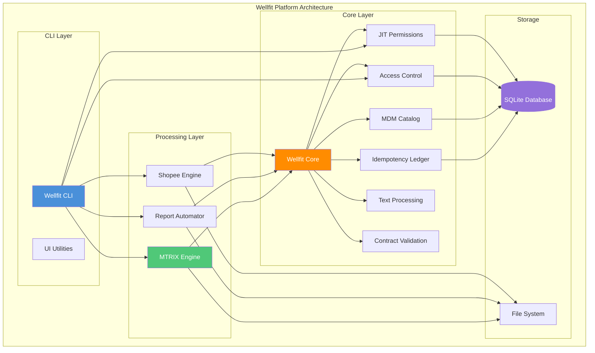

---

## 2. MTRIX Processing Pipeline

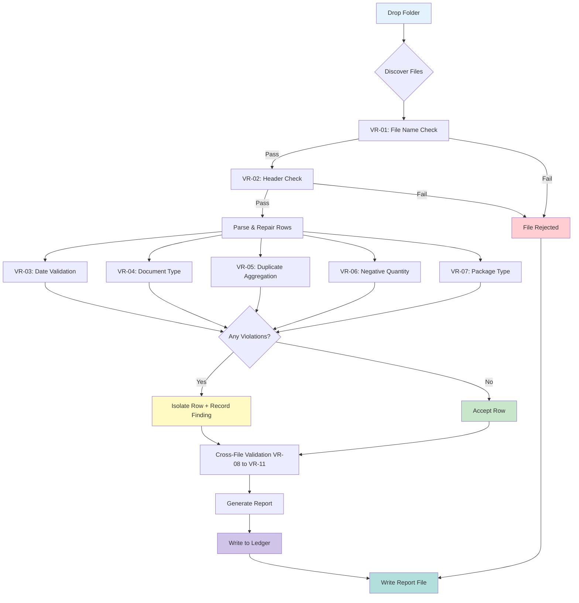

---

## 3. Access Control Flow (RBAC/ABAC)

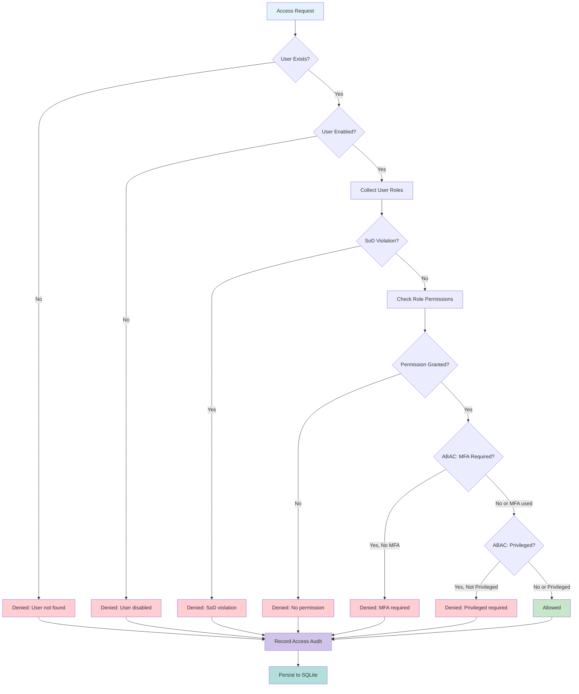

---

## 4. JIT Permission Workflow

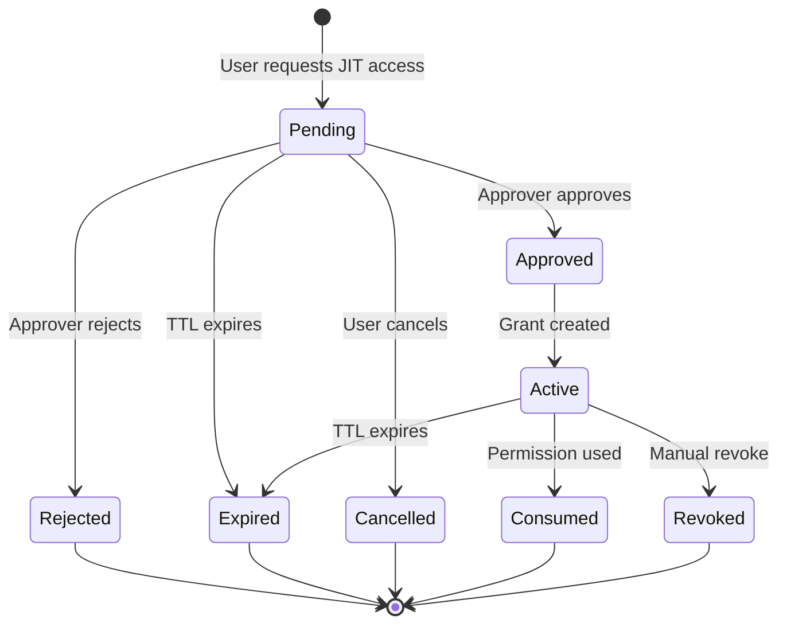

---

## 5. Ledger Idempotency Flow

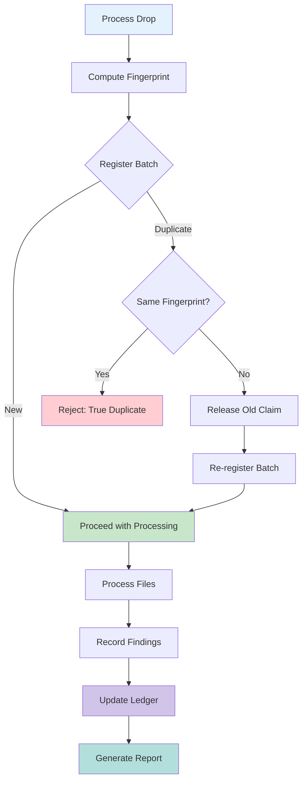

---

## 6. Release Gate State Machine

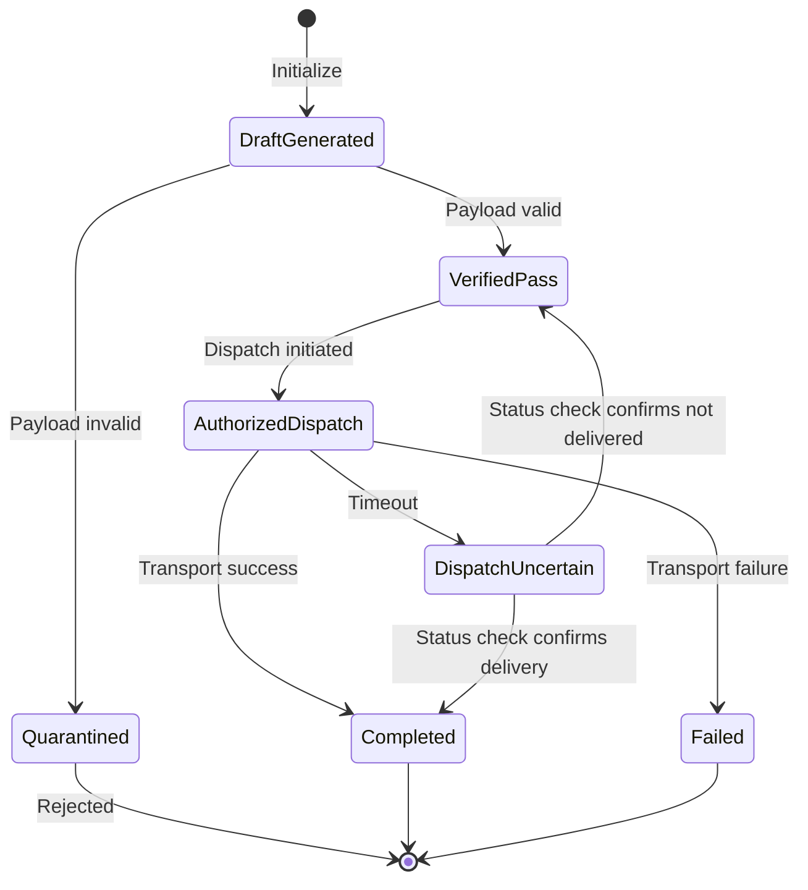

---

## 7. ISO 27001:2022 Implementation Roadmap

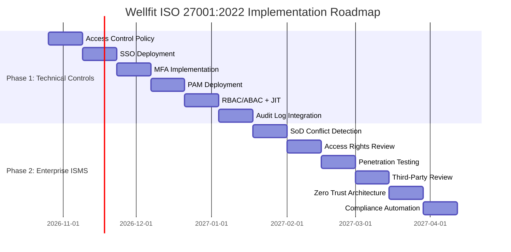

---

## 8. Fault Injection Test Flow

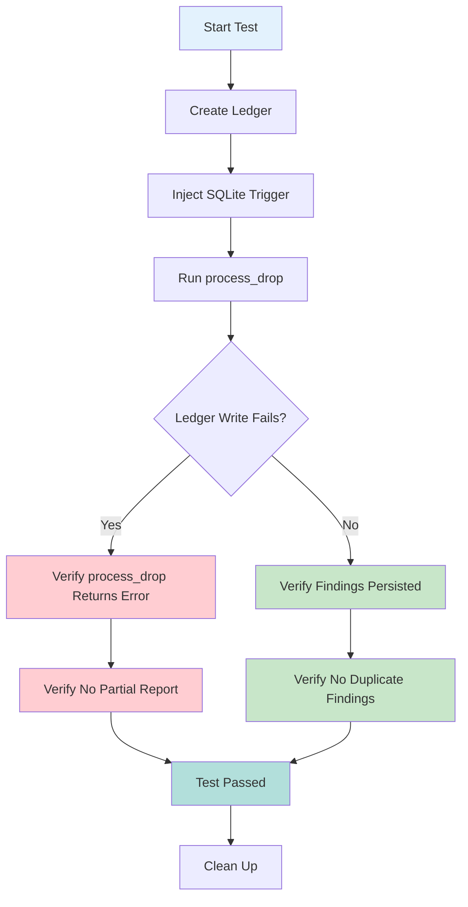

---

## 9. Supply Chain Security Pipeline

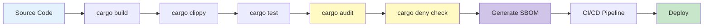

---

## 10. Multi-Standard Alignment

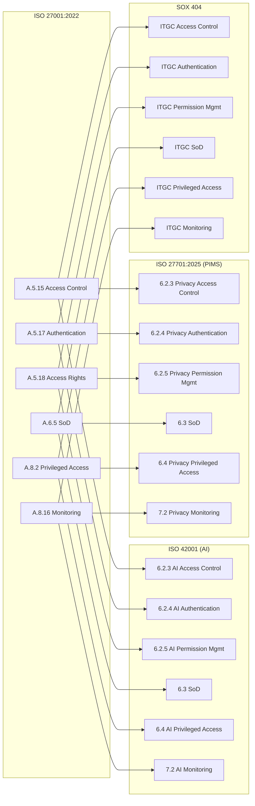

---

## 11. Wellfit Data Flow

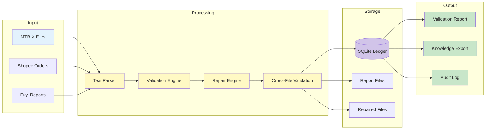

---

## 12. Quality Gates (G0-G7)

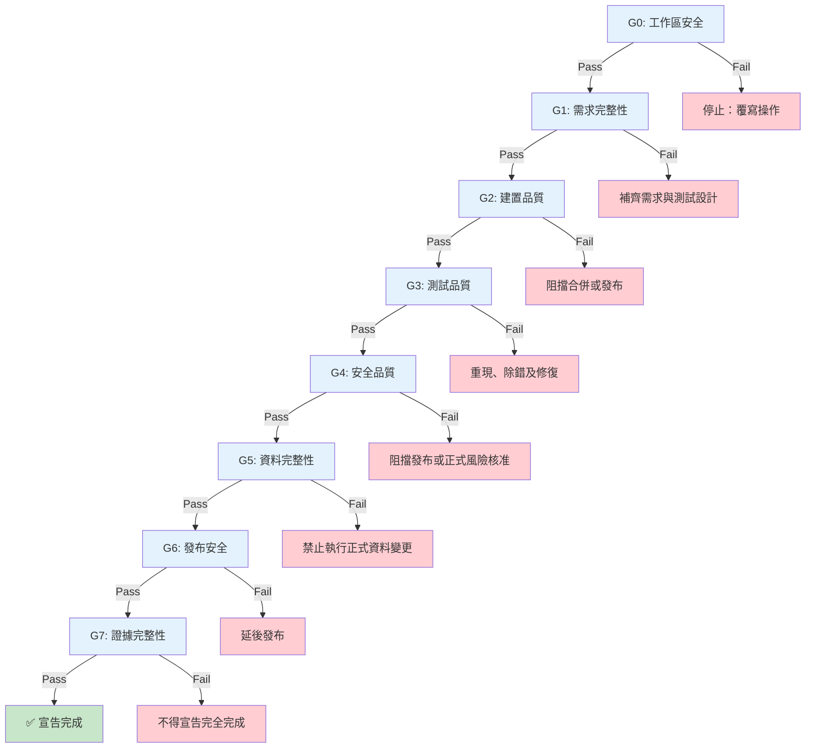

---

## 13. PDCA Continuous Improvement Cycle

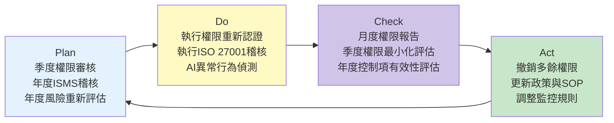

---

## 14. Risk Management Process

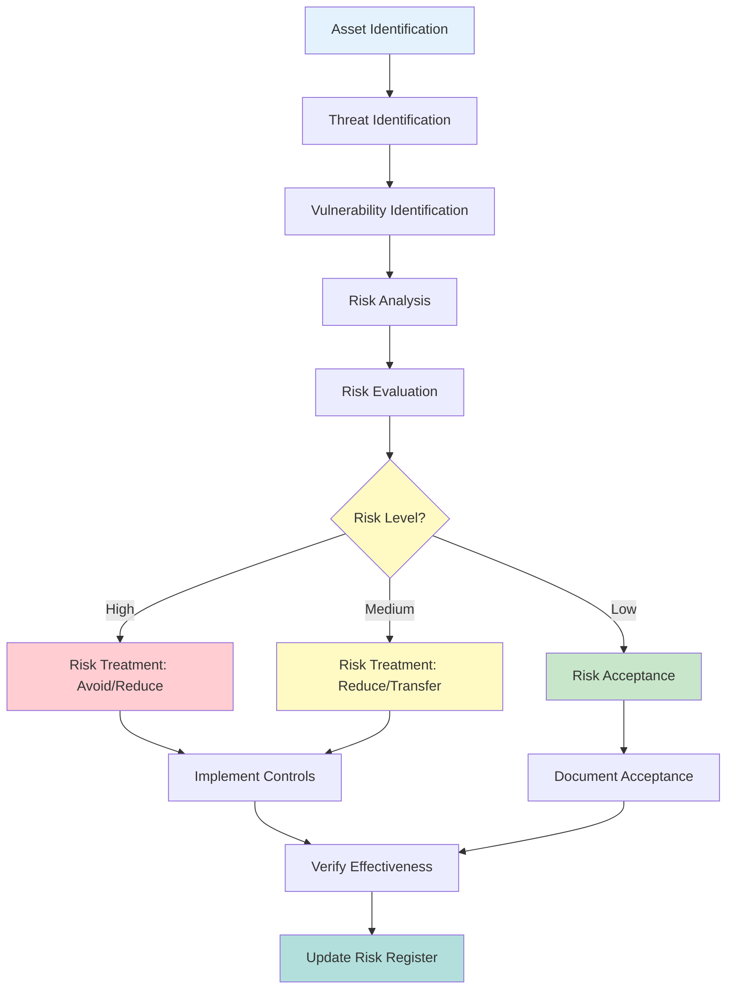

---

## 15. Wellfit Deployment Pipeline

---

## Document Index

| Document | ID | Location |
|----------|-----|----------|
| KNB-MASTER.md | KNB-MASTER | `~/.local/share/kilo/plans/` |
| KNB-ENG-SYSTEM.md | KNB-ENG-SYSTEM | `~/.local/share/kilo/plans/` |
| KNB-PHASE2.md | KNB-PHASE2 | `~/.local/share/kilo/plans/` |
| KNB-INDUSTRY-MASTER.md | KNB-INDUSTRY-MASTER | `~/.local/share/kilo/plans/` |
| ADR-TEMPLATE.md | ADR-TEMPLATE | `Wellfit/plans/adr/` |
| ADR-0001 | ADR-0001 | `Wellfit/plans/adr/` |
| ADR-0002 | ADR-0002 | `Wellfit/plans/adr/` |
| ADR-0003 | ADR-0003 | `Wellfit/plans/adr/` |
| requirements-traceability.md | RTM-001 | `Wellfit/plans/` |
| iam-evaluation.md | IAM-EVAL | `Wellfit/plans/` |
| pam-evaluation.md | PAM-EVAL | `Wellfit/plans/` |
| multi-standard-matrix.md | MULTI-STD | `Wellfit/plans/` |
| industry-standards-implementation.md | INDUSTRY-IMPL | `Wellfit/plans/` |
| phase2-deployment-runbook.md | PHASE2-DEPLOY | `Wellfit/plans/` |
| keycloak-realm-export.json | KEYCLOAK | `Wellfit/plans/` |
| vault-policy.hcl | VAULT | `Wellfit/plans/` |
| wazuh-agent.conf | WAZUH-AGENT | `Wellfit/plans/` |
| wazuh-rules.xml | WAZUH-RULES | `Wellfit/plans/` |
| scripts/daily-backup.ps1 | BACKUP | `Wellfit/scripts/` |
| scripts/restore.ps1 | RESTORE | `Wellfit/scripts/` |
| deny.toml | DENY | `Wellfit/` |
| .github/workflows/security.yml | SECURITY-CI | `Wellfit/.github/workflows/` |

---

**本文件為 Wellfit 系統完整架構與流程圖參考，所有流程圖使用 Mermaid 語法，可在 GitHub、GitLab、VS Code、Obsidian 等支援 Mermaid 的工具中渲染。**
